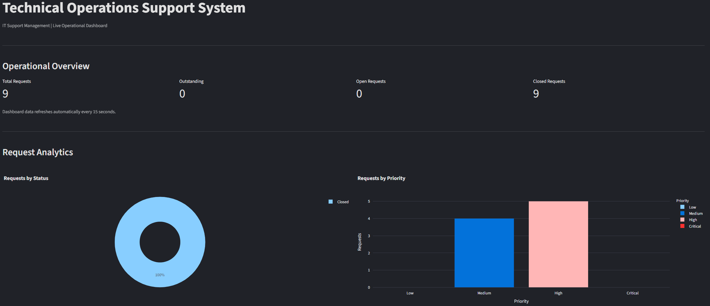
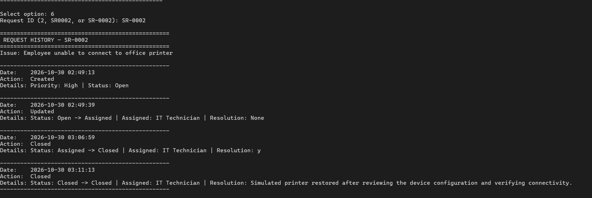
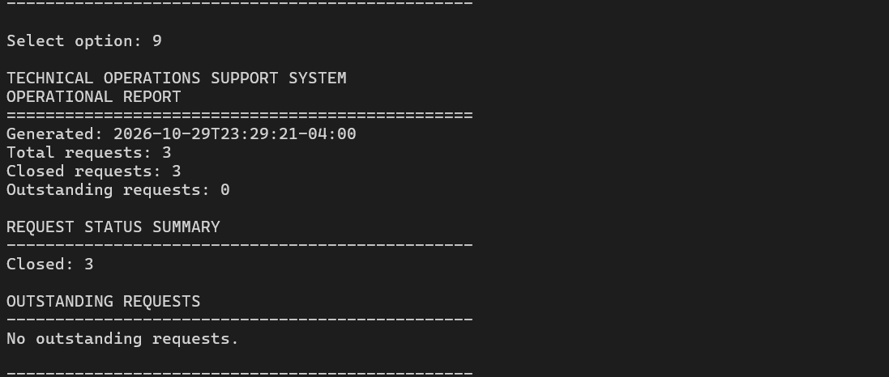

# Technical-Operations-Support-System (TOSS)

**IT Support • Records Management • Troubleshooting • Workflow Tracking**

`Python` · `SQLite` · `Streamlit` · `Plotly`

---

## Overview

Technical Operations Support System (TOSS) is a Python-based application for managing IT support requests, tracking technical issues, and maintaining operational records.

It provides a centralized way to create requests, assign work, document troubleshooting, track progress, and record resolutions.

---

## Key Features

- **Request Management** — Create, search, assign, prioritize, and track support requests.
- **Ticket Workflow** — Move requests through statuses from open to resolved or escalated.
- **Troubleshooting Records** — Document resolution notes and maintain request history.
- **Data Management** — Store and retrieve support records using SQLite.
- **Operational Reporting** — Review request activity, status breakdowns, and workload through dashboard charts.
- **Data Verification** — Check records for missing information, duplicates, and errors.

---

## Support Workflow

`Request → Triage → Assign → Troubleshoot → Resolve / Escalate → Document → Close`

---

## Running the Dashboard

Install the project dependencies:

```bash
python3 -m pip install -r requirements.txt
```

Start the dashboard:

```bash
streamlit run src/dashboard.py
```

Open the local URL displayed in the terminal.

For CLI instructions, see [docs/USAGE.md](docs/USAGE.md).

---

## Testing

Run the automated tests:

```bash
python3 -m unittest discover -s tests -v
```

---

## Development

**Status:** In Development

Developed and tested locally using Python, SQLite, Ubuntu Linux, and Windows 11.

All sample requests and support scenarios use fictional data.

---

## Application Preview

**Main Menu**



**Request History**



**Operational Report**


